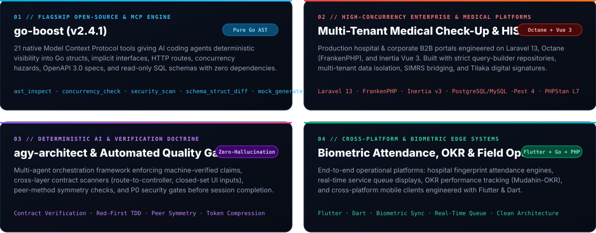
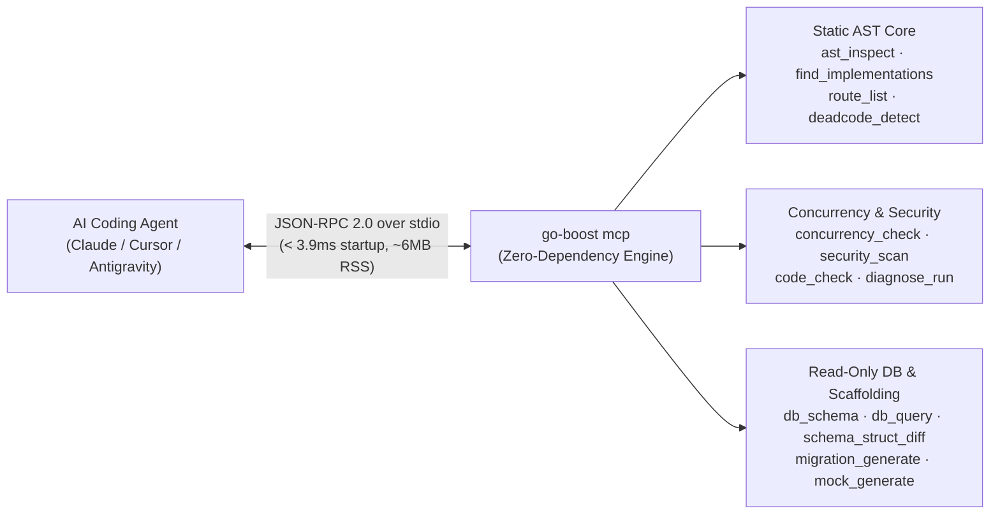

<div align="center">

<!-- BESPOKE ANIMATED TELEMETRY COCKPIT (ZERO EXTERNAL VERCEL DEPENDENCY) -->
<a href="https://github.com/wahyunoerr/go-boost">
  
</a>

<br/>

[](https://pkg.go.dev/github.com/wahyunoerr/go-boost/v2)
[](https://github.com/wahyunoerr/go-boost)
[](https://wahyunoerr.github.io)
[](https://www.instagram.com/wnur.id/)
[](mailto:wahyunoer1001@gmail.com)

</div>

---

### `// 0x01` — Architectural Bento Matrix

<div align="center">
  
</div>

---

### `// 0x02` — Featured Engineering Spotlight: [`go-boost`](https://github.com/wahyunoerr/go-boost)

> **The Native AI Acceleration & Model Context Protocol (MCP) Suite for Go.**  
> Built directly on the Go standard library (`go/parser`, `go/ast`, `go/token`) with **zero external module dependencies**, **3.9 ms cold start**, and **21 native tools** for Claude Code, Cursor, Google Antigravity, Codex CLI, Windsurf, and VS Code Copilot.

```bash
# Install as a Go 1.24+ project tool or standalone binary
go get -tool github.com/wahyunoerr/go-boost/v2/cmd/go-boost@latest
go tool go-boost init
```

<details>
<summary><b>⚡ Inspect Live MCP Architecture &amp; 21-Tool Matrix (Click to Expand)</b></summary>
<br/>



| Domain | Native MCP Tools Provided by `go-boost` |
| :--- | :--- |
| **AST & Architecture** | `app_info` · `ast_inspect` · `find_implementations` · `route_list` · `deadcode_detect` · `go_doc` |
| **Concurrency & Safety** | `concurrency_check` *(goroutine leak, unclosed context timer, mutex unlock audit)* · `security_scan` *(SQLi, secrets, TLS, SARIF)* · `code_check` |
| **Database & Schema** | `db_connections` · `db_schema` · `db_query` *(strictly read-only)* · `schema_struct_diff` · `migration_generate` |
| **Testing & Runtime** | `mock_generate` *(generics + embedded interfaces)* · `test_runner` · `bench_runner` · `openapi_generate` · `diagnose_run` · `read_logs` · `last_error` |

</details>

---

### `// 0x03` — Production Technology Radar

| Layer | Primary Production Stack | Architectural Discipline |
| :--- | :--- | :--- |
| **Systems & AI Tooling** |    | Zero-dependency static AST analysis, race-detector gates (`-race`), deterministic CLI & stdio servers |
| **Enterprise Backend** |    | FrankenPHP persistent workers, explicit query-builder repositories, multi-tenant boundary enforcement, PHPStan L7 |
| **Frontend & Mobile** |    | Typed Wayfinder route contracts, Tailwind v4, closed-set input validation, high-density print & medical layouts |
| **Data & Infrastructure** |     | Zero-downtime SQL migrations, struct-to-schema drift verification, read-only introspection guards |

---

<div align="center">
  <sub>Engineered with precision by <b>Wahyu Nur (@wahyunoerr)</b> · Custom Vector Telemetry HUD</sub>
</div>
